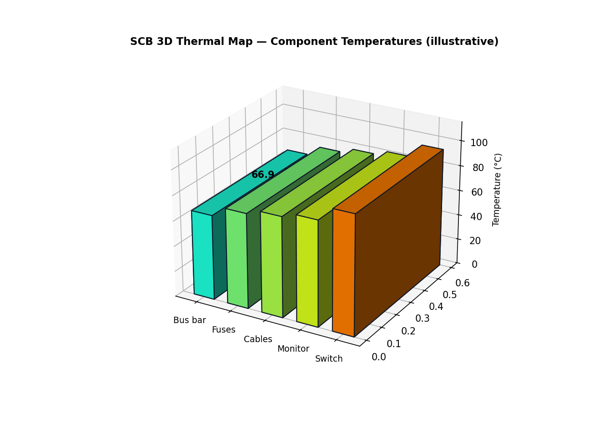
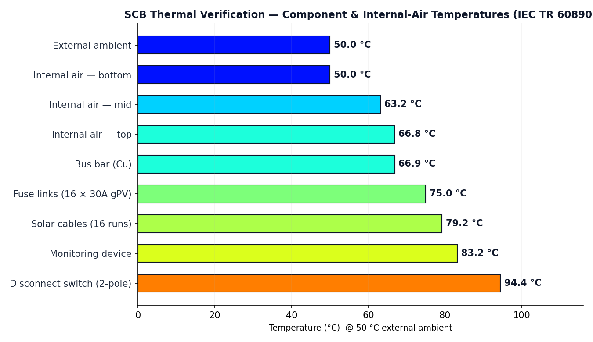

# Solar String Combiner Box — Thermal Verification & 3D Thermal Visualization

**Evidence-led enclosure temperature-rise verification by calculation (IEC TR 60890 / IEC 61439-1), delivered as an interactive report and a 3D thermal map.**

> **Notice** — This repository is a public project showcase created using NebulaCloud Studio. The proprietary source code, implementation details, prompts, workflows, datasets, infrastructure, and deployment configuration are intentionally not included.

---

## Overview

Solar DC combiner boxes (SCB / string combiner boxes) concentrate fuse links, copper busbars, DC disconnectors, cabling and monitoring electronics inside a sealed IP66 enclosure. Before a box can be deployed on a solar farm at a 50 °C ambient, an engineer must answer one question with evidence: **how hot does the air inside the enclosure get, and how hot does each component get?**

This showcase demonstrates a vendor-neutral, evidence-led thermal verification workflow for a 16-input / 1-spare string combiner box. It computes the internal air temperature rise using the IEC TR 60890 method (as referenced by IEC 61439-1), applies a first-order material correction for the FRP (glass-fibre reinforced polyester) enclosure, estimates each component's self-heating, and presents the result in two forms: a calculation report and an interactive 3D thermal map.

The focus is on **what the application produces** — a defensible thermal result with an explicit evidence trail — not on how it is implemented.

---

## Business Problem

Electrical assemblies for solar generation are thermally demanding and commercially consequential:

- **Concentrated heat.** Fuse links, busbars, disconnectors and monitoring electronics dissipate tens of watts inside a sealed enclosure.
- **High ambient.** Outdoor solar combiner boxes must be verified at a 50 °C external ambient, leaving a narrow margin to the 85 °C rating of typical components.
- **Input fragmentation.** Loss values come from separate datasheets and engineering assumptions; a result that mixes the two looks confident but is not defensible.
- **Material sensitivity.** IP66 FRP enclosures dissipate heat differently from the sheet-steel enclosures the standard method assumes.
- **Verification burden.** A full laboratory type-test is costly and slow; teams need a calculation they can review before procurement.

Without a structured, evidence-led calculation, a designer is left with either an unsupported "it should be fine" or an expensive over-engineered enclosure.

---

## Solution Overview

The workflow turns a bill of materials, an enclosure definition and an ambient condition into a reviewable thermal verdict:

1. **Loss register** — every heat source is listed with its power loss and tagged by evidence quality (published vs. assumed vs. missing).
2. **Enclosure heat transfer** — effective cooling surface `Ae` from dimensions and installation, plus an FRP wall-conduction correction against the sheet-steel reference.
3. **Internal air temperature rise** — IEC TR 60890 non-ventilated curve gives Δt at bottom, mid-height and top of the enclosure.
4. **Component temperature rise** — first-order self-heating (P / h·A) added on top of the local air temperature.
5. **Verification gates** — the verdict is **blocked** when the BOM is incomplete, when losses are not datasheet-backed, or when method applicability is not confirmed.
6. **Visualisation** — a 3D thermal map colours every component on a jet scale for rapid design review.

The result is a verification **by calculation**, clearly labelled as such — never a laboratory type-test certificate.

---

## Live Demo

Two interactive, fully client-side demonstrations ship with this showcase (no backend, no data leaves the browser):

- **[Thermal calculation report](demo/thermal-report.html)** — the IEC TR 60890 calculation, loss register, FRP material correction, component temperatures and verification gates.
- **[3D thermal map](demo/thermal-3d.html)** — an interactive Three.js scene of the enclosure with components coloured by temperature; drag to orbit, scroll to zoom, hover for values.

Open either file directly in a modern browser. No installation, no sign-up, no telemetry.

---

## Demo Video

A walkthrough video is available on request from the project owner. (No video file is bundled in this public showcase.)

---

## Project Screenshots





*(High-resolution captures of the two live demos above.)*

---

## Generated Outputs

The following outputs are produced by the application and reproduced in this showcase:

| Output | Description |
|---|---|
| **Loss register** | Per-component power loss with evidence classification (all "assumed" in the public sample). |
| **Internal air temperatures** | Bottom 50.0 °C · mid-height 63.2 °C · top 66.8 °C (FRP, 50 °C ambient). |
| **Component temperatures** | Busbar 66.9 °C · fuse links ≈75 °C · cables 79.2 °C · monitoring 83.2 °C · disconnect switch 94.4 °C. |
| **Verification verdict** | BLOCKED (0 % datasheet-backed) — screening only, not a certified pass. |
| **3D thermal map** | Interactive, colour-coded enclosure scene with hover tooltips and a temperature legend. |

All values are representative screening results produced from a sample bill of materials; they are not a certified compliance statement.

---

## Key Features

- **Vendor-neutral** — any component with a known watt loss can be modelled, regardless of manufacturer.
- **Evidence classification** — every loss line is tagged published / assumed / missing, with the datasheet-backed share reported.
- **IEC TR 60890 calculation** — internal air rise at bottom, mid-height and top, with enclosure constant `k`, distribution factor `c`, exponent and partition factor.
- **FRP material correction** — first-order adjustment for non-metallic enclosure walls against the sheet-steel reference.
- **Component self-heating** — first-order P / (h·A) estimate per component.
- **Design-verification gates** — blocks a "verified" verdict when essential evidence is absent.
- **3D thermal visualisation** — jet colour scale, orbit/zoom, hover tooltips, labels, legend and auto-rotate.
- **Print-ready report** — clean, reviewable calculation basis and limitations.

---

## Intended Users

| Audience | Relevant Application |
|---|---|
| Switchgear & panel builders | Early screening of enclosure temperature rise for a proposed BOM. |
| Electrical design engineers | Communicating a temperature-rise check with an explicit evidence trail. |
| Solar EPC & O&M teams | Verifying DC combiner boxes against 50 °C ambient site conditions. |
| Product & application engineers | Comparing enclosure size, material and ventilation options. |
| Technical reviewers | Reviewing which inputs are datasheet-backed versus assumed before sign-off. |

---

## Example Use Cases

- Pre-procurement thermal screening of a 16-input solar combiner box before committing to an enclosure size.
- Comparing sheet-steel versus FRP enclosure materials for the same internal heat load.
- Re-evaluating a BOM when a fuse or disconnect switch is substituted for a different manufacturer.
- Producing a review-ready evidence register for a design review or third-party check.
- Rapid thermal visualisation for customer presentations and training.

---

## Technical Highlights (High-Level Only)

| Capability | Technology / Method |
|---|---|
| Calculation engine | IEC TR 60890 verification-by-calculation method (referenced by IEC 61439-1). |
| Evidence model & gates | Verification layer that classifies loss evidence and blocks unsupported verdicts. |
| Material correction | First-order U-value adjustment for FRP walls (k ≈ 0.25 W/(m·K)). |
| 3D visualisation | Three.js / WebGL, client-side, responsive, interactive. |
| Deployment model | Fully static; all computation runs in the browser. |

*(Implementation, prompts, workflows and internal logic are intentionally not included.)*

---

## Architecture Overview (Conceptual Only)

```
Inputs                          Processing                        Outputs
─────────────                   ──────────────────────            ─────────────────────
Bill of materials  ──►  Loss register (evidence-tagged)  ──►  Calculation report
Enclosure (size,    ──►  Effective cooling surface Ae          Component temperatures
  material, mount)  ──►  IEC TR 60890 air temperature rise     Verification verdict
Ambient & limits    ──►  FRP material correction               (BLOCKED / VERIFIED)
                          Component self-heating (P/h·A)       3D thermal map
```

This is a conceptual user journey only — it is not an implementation or service-topology disclosure.

---

## Technical Scope & Limitations

- The result is a temperature-rise verification **by calculation** (IEC TR 60890, referenced by IEC 61439-1). It is **not** a laboratory type-test and **not** a certified compliance statement.
- Table-driven factors (surface weighting, `k`/`c` curves, exponent) follow the published IEC method structure and must be reconciled against the licensed standard text for certified use.
- IEC TR 60890 is calibrated for sheet-steel enclosures; the FRP correction used here is a first-order engineering adjustment, not a certified factor.
- Component temperatures are first-order P / (h·A) screening estimates with assumed cooling areas; certified values require manufacturer device thermal data.
- The 3D thermal map is an **illustrative procedural approximation** (representative geometry and positions), not a measured thermal image or CFD result.
- The public sample BOM is illustrative and must not be used for real design decisions.

---

## Performance Summary (Verified Only)

The following figures were reproduced and verified for the sample scenario (16 × 15.08 A strings, 64.6 W total loss, 850×700×300 mm IP66 FRP enclosure, 50 °C ambient):

| Quantity | Value |
|---|---|
| Effective cooling surface `Ae` | 1.929 m² |
| Enclosure constant `k` / distribution factor `c` | 0.429 / 1.274 |
| Internal air rise — mid / top | 13.2 K / 16.8 K |
| Internal air temp — bottom / mid / top | 50.0 / 63.2 / 66.8 °C |
| FRP correction factor | 1.077 |
| Hottest component (disconnect switch) | 94.4 °C |

These are arithmetic results of the calculation method, not physical test measurements.

---

## Attribution

- **IEC TR 60890** and **IEC 61439-1** — referenced standards, © International Electrotechnical Commission; not reproduced in this repository.
- **ETI** — published gPV fuse dissipation endpoints used to cross-check fuse self-heating.
- **Trinity Touch** — publicly documented 16-in-1-out combiner box used as a reference product.
- **Three.js** — WebGL library (MIT), loaded from a CDN for the 3D visualisation.

Full details and licences are in [ATTRIBUTIONS.md](ATTRIBUTIONS.md).

---

## Built with NebulaCloud Studio

This project was created using [NebulaCloud Studio](https://nebulacloud.studio), an agentic application-building platform for engineering, scientific, geospatial and interactive digital workflows. NebulaCloud Studio helps domain professionals turn ideas, models, datasets and algorithms into usable, deployable applications.

---

## Related Project Showcases

- **Thermal Verification Workbench** — a vendor-neutral enclosure temperature-rise workbench (IEC TR 60890 / IEC 61439-1).
- **Solar Combiner Thermal Engineering** — an evidence-led thermal case study of a published DC combiner box.

Additional engineering, geospatial and interactive showcases are listed on the [Studio demos catalogue](https://studio-public-demos.github.io/).

---

## Call to Action

Working with switchgear enclosures, solar combiner boxes, or other electrical assemblies that need defensible thermal verification?

- Explore the live demos in this repository.
- See the broader portfolio at [studio-public-demos.github.io](https://studio-public-demos.github.io/).
- Discuss a private engineering engagement at [nebulacloud.studio](https://nebulacloud.studio).

---

## License

This repository's license applies only to the showcase materials included here. It does **not** grant rights to the source code, the Studio platform, proprietary workflows, internal prompts, models, datasets, hosted services or trademarks. See [LICENSE](LICENSE).
